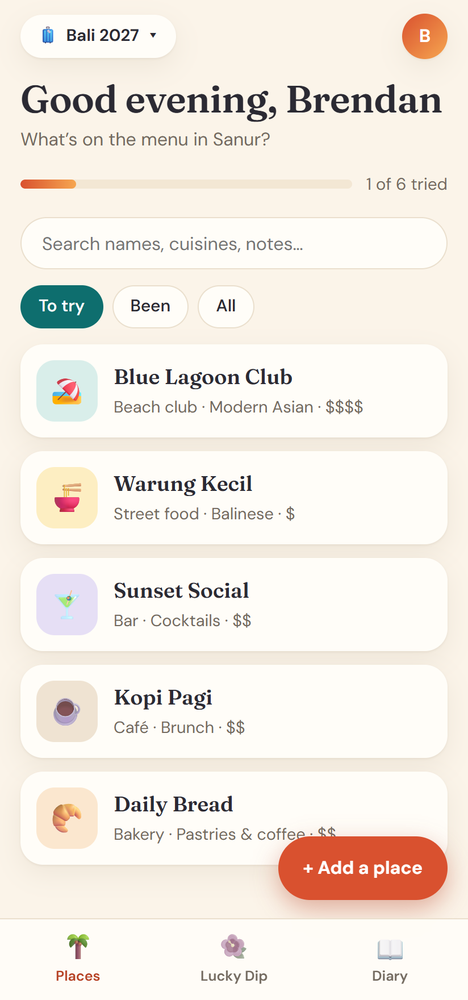
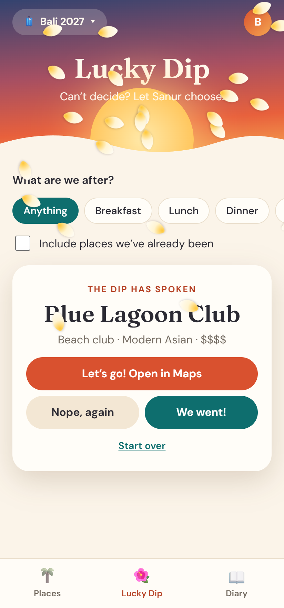
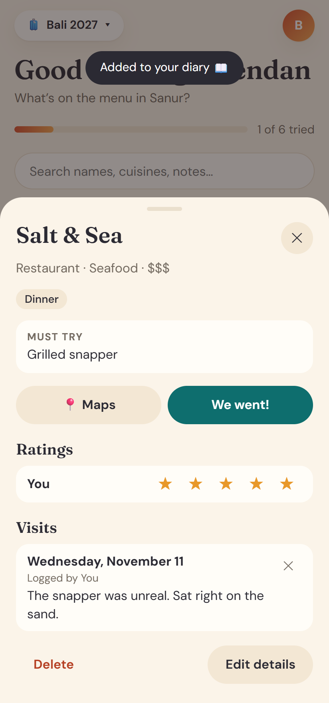
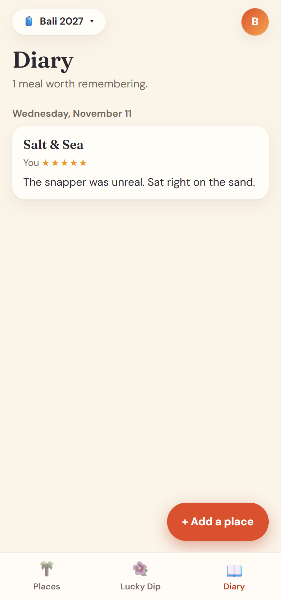

# TripTaster

A self-hosted food diary for trips with friends. Collect the restaurants, cafés and bars you want to
try, keep a diary of the meals you loved, and when nobody can decide, let the **Lucky Dip** choose.

It's a phone-friendly web app you install to your home screen, backed by a tiny Node server and a
SQLite file. There are no npm dependencies, and it fits in one small Docker container.

<p>
  
  
  
  
</p>

## Features

- **Places:** name, type, meals, cuisine, price, Maps link, must-try dish and notes. Search, and filter by *To try* or *Been*.
- **Lucky Dip:** pick a meal, spin, and get an answer, with a shower of frangipani petals. *Nope, again* rules a place out and spins again.
- **Diary:** a dated record of every visit, with everyone's own star ratings.
- **Trips:** keep each trip and city separate.
- **Shared:** everyone on your server sees the same lists, and phones stay in sync.
- **Installable and offline-friendly:** lists and the Lucky Dip keep working with no signal.
- **Share from Google Maps** on Android to pre-fill a new place.
- **Sign in** with a username and password, single sign-on through any OpenID Connect provider, or both.
- **Invite links** for new people, plus admin and member roles.
- **Backup and restore** as a JSON file.

## Quick start

```sh
mkdir triptaster && cd triptaster
curl -LO https://raw.githubusercontent.com/butterboy77/triptaster/main/docker-compose.yml
curl -L -o .env https://raw.githubusercontent.com/butterboy77/triptaster/main/.env.example
# Edit .env and set BASE_URL to the address you'll use.
docker compose up -d
docker logs triptaster     # shows your one-time setup code
```

Open your `BASE_URL`, enter the setup code, and create the admin account. Then use
**Settings → Invite someone** to send invite links.

To install it on a phone, open the site in **Chrome** on Android or **Safari** on iPhone and choose
*Add to Home screen* or *Install*. Installing requires HTTPS, so put TripTaster behind a reverse
proxy with a certificate (Nginx Proxy Manager, Caddy, Traefik, and so on) and set `TRUST_PROXY=true`.
On Android, Maps sharing only works when installed through Chrome.

## Configuration

Everything is set with environment variables, usually in `.env`:

| Variable | Default | Purpose |
|---|---|---|
| `BASE_URL` | *(required)* | The address people use, e.g. `https://food.example.com` |
| `TRUST_PROXY` | `false` | Set to `true` behind a reverse proxy, so failed sign-ins are tracked per visitor |
| `PASSWORD_LOGIN` | `true` | Username and password sign-in |
| `OIDC_ISSUER` | | Turns on single sign-on, e.g. `https://id.example.com` |
| `OIDC_CLIENT_ID` | | From your provider |
| `OIDC_CLIENT_SECRET` | | From your provider. Leave empty for public clients using PKCE only |
| `OIDC_LABEL` | `Single sign-on` | Button text, e.g. `Pocket ID` |
| `OIDC_AUTO_REGISTER` | `false` | Give an account to anyone your provider signs in, without an invite |
| `OIDC_ALLOWED_GROUPS` | | Comma-separated groups, read from the `groups` claim, allowed in |
| `PORT` | `3000` | Port inside the container |
| `DATA_DIR` | `/data` | Where the database lives |

### Single sign-on

Create a client with your provider using the callback URL `<BASE_URL>/auth/oidc/callback` and the
scopes `openid profile email` (plus `groups` if you use `OIDC_ALLOWED_GROUPS`). Then set
`OIDC_ISSUER`, `OIDC_CLIENT_ID` and `OIDC_CLIENT_SECRET`.

- Without `OIDC_AUTO_REGISTER`, people need an invite link. They can join through single sign-on from it.
- People with a password can link single sign-on from Settings.
- For single sign-on only, set `PASSWORD_LOGIN=false`. During first-run setup, enter the code and choose *Continue with…*.

## Admin tasks

```sh
docker exec triptaster node cli.js list-users
docker exec triptaster node cli.js reset-password <username>   # prints a reset link
docker exec triptaster node cli.js invite-admin                 # if every admin is locked out
```

## Backups

Admins can use **Settings → Download backup** to get a JSON file, and **Restore trips** to add one
back. Restoring adds the trips as new ones rather than overwriting. To copy the whole database,
including people:

```sh
docker exec triptaster node -e "new (require('node:sqlite').DatabaseSync)('/data/triptaster.db').exec(\"VACUUM INTO '/data/backup.db'\")"
docker cp triptaster:/data/backup.db ./triptaster-backup.db
```

## Development

You need Node 24 or newer, and there's nothing to install.

```sh
BASE_URL=http://localhost:3000 npm start
npm test
```

The code is plain JavaScript with no build step:

| Path | Contents |
|---|---|
| `src/app.js` | Routes and business logic |
| `src/auth.js` | Passwords, rate limiting and OpenID Connect |
| `src/db.js` | Schema and migrations |
| `public/` | The app itself (HTML, CSS, JavaScript and service worker) |

Pull requests are welcome. Please include tests for new behaviour.

## Licence

MIT. See [LICENSE](LICENSE). The Fraunces and DM Sans fonts are under the SIL Open Font License.
